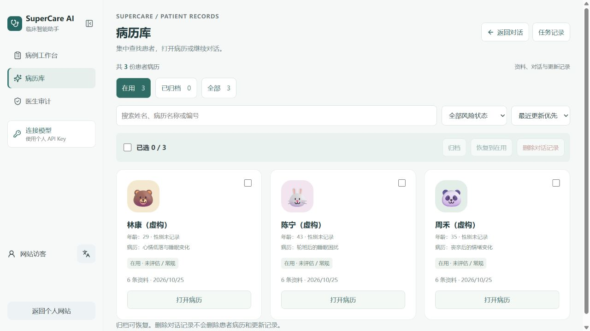
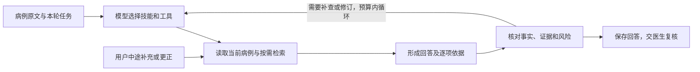

# Clinical Agent · 病例工作台

面向低年资及非精神科医生，辅助整理患者信息、查阅医学资料，并围绕同一病例持续讨论。当前工作台界面使用 **SuperCare AI** 名称：先看清病例事实，再核对回答和证据，最后记录医生意见。

[打开在线工作台](https://dominicspace.com/apps/clinical/) · [下载网页版构建包](https://github.com/DominicHongliDing/Clinical-Agent/releases/tag/website-2026.10.25) · [产品设计](docs/product-design.md) · [本轮能力改造 PRD](docs/PRD-v0.4.md) · [2026-10-25 更新与验证](docs/releases/2026-10-25.md)

## 现在可以体验什么

1. 打开工作台即可浏览 **3 例虚构病例、6 份实际生成并保存的回答与引用**，无需 API Key。
2. 从病历库进入患者病历，在 EHR 模块中查看原始资料、补充与更正；姓名、年龄和性别同步到列表与聊天页。
3. 回到对话继续提问，按需收起侧栏、患者上下文与证据栏，为回答留出阅读空间。发送新问题需要通过「连接模型」配置自己的 API Key。
4. 进入医生审计，依次选择回答、对照病例与证据、记录结论。领取后保留当前步骤；提交后刷新可看到会话内记录。

线上病例与审计记录保存在**当前浏览器会话**，刷新可恢复；关闭会话、清除存储或换设备不能保证保留。个人 Key 仅在运行时内存中使用。网页版继续使用既有 BYOK 网关，完整自主 Agent 与 PostgreSQL 数据库运行在本地，尚未作为这次网站更新部署。

## 围绕医生任务组织信息

| 医生的任务 | 当前设计 | 核对重点 |
| --- | --- | --- |
| 整理病例 | 来源事实、未知与冲突分列，EHR 保留材料与更新记录 | 是否符合原文；未知不能被写成阴性 |
| 补充或更正 | 保留原话与时间顺序，当前病例采用最新明确更正 | 后续回答有无遗漏更正；切换患者有无串用 |
| 查证医学资料 | 回答、引用与原文对照，说明适用范围和限制 | 来源是否支持具体主张、适用于当前患者 |
| 复核结果 | 三步审计，保留回答快照、证据与意见 | 软件检查、模型复核和医生确认分别记录 |
| 管理病历 | 搜索、风险筛选、排序、头像、归档与批量操作 | 删除对话不等于删除患者病历与更新材料 |

## 本地 Agent 的最新能力

- **任务调度**：保留 Python / FastAPI / PostgreSQL / React 栈，由模型按任务选择、组合技能与受限工具，在预算内循环；没有为每个问题固定整条路由。
- **病例上下文**：病例事实与最近几轮对话保留原文，接近预算时才压缩旧对话；证据按需读取，病例之间隔离。
- **RAG**：查询改写、BM25、百炼语义检索、受控同义词、RRF 融合与百炼重排；保留来源及索引版本。
- **分层回答**：八类技能中，病例整理与鉴别评估完成 v0.4 试点；摘要、详情、限制和引用随回答快照保存。
- **运行可靠性**：支持中途补充、取消、断流后的状态查询、幂等回执，以及同机进程退出识别和已保存结果恢复。

完整自主调度与数据库能力属于本地版本；[产品设计中的范围对照](docs/product-design.md#网页版与本地版)说明线上实际覆盖情况。应用源码目前未公开，本仓库提供产品文档、界面截图与版本说明。

## 验证到了哪一步

2026-10-25 本地两技能基线使用真实接口、PostgreSQL 与百炼，6 个虚构病例共 12 次请求，完成与持久化均为 **12/12**；提交的 **14/14** 条引文能匹配来源原文。另有 **679 项确定性测试**通过。真实浏览器已检查生成、更正、切换病例、审计提交及刷新，以及桌面和窄屏关键流程。

网站同步另通过 TypeScript / Vite 构建、14 项适配器夹具检查，以及正式域名上的浏览、审计提交与刷新验证；这次网站同步没有新增付费模型生成测试。工程结果不等于临床支持率：**独立医生评分、参考回答与 RAG 独立标注仍待完成**，也没有真实临床试点或八技能临床批准。[查看样本范围与验证限制](docs/releases/2026-10-25.md)

## 历史问题与后续工作

“病程两周更正为三天后仍重复信息不足提示”的[历史失败案例](docs/cases/patient-correction.md)保留原样。新版已另行验证连续更正、病例隔离和刷新保存；不同输入的后续测试不能冒充该历史场景的同条件复测。

后续由医生完成独立评审与证据适用性标注，再决定质量阈值及其余六技能的推广。持久 worker、跨进程续跑和额外并行仍按长任务需求评估。[原始 14 节立项 PRD](docs/PRD.md)作为历史需求保留，本轮实现范围见 [v0.4 PRD](docs/PRD-v0.4.md)。

## 需求来源与我的工作

在卡罗莱纳精神病研究所实习期间，我参与 VedAI 的需求研究、原型验证与上线，定期与项目负责人、精神科医生和前后端工程师沟通。上下文遗漏、证据利用不足和回答过于确定的反馈，促使我继续设计个人项目 Clinical Agent。

我负责把这些反馈落实为病例信息规则、证据核对、医生复核和验收要求，并借助 AI 编程工具实现、测试和迭代个人原型。当前重点是让整理、查证与复核过程可理解、可追溯，临床适用性由独立专业评阅确认。
