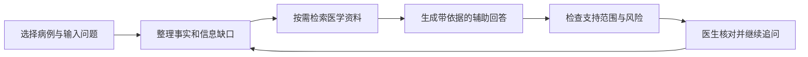

# Clinical Agent · 病例工作台

Clinical Agent 面向低年资及非精神科医生，辅助整理患者信息、查阅医学资料，并围绕同一病例持续讨论。医生可以核对摘要、引用和待补信息，再决定是否采用。工作台原名 SuperCare AI。

当前提供在线演示与产品设计文档，尚未公开 Clinical 应用源码，也未开展真实临床试点。临床判断由医生负责。

[在线示例与工作台](https://dominicspace-agent-showcase.peterzhukejie2020.chatgpt.site/apps/clinical/index.html) · [产品设计](docs/product-design.md) · [完整 PRD](docs/PRD.md)

## 主要用途

| 医生的任务 | 工作台提供什么 | 需要核对什么 |
| --- | --- | --- |
| 整理较长的病例叙述 | 病例摘要、已知事实与缺失信息 | 是否符合原文、有无遗漏 |
| 围绕同一患者继续提问 | 沿用当前病例信息，结合补充与更正回答 | 是否采用最新内容、属于当前患者 |
| 查指南和用药资料 | 检索结果、引用及适用范围 | 来源可靠性与患者适用性 |
| 准备问诊或病例讨论 | 待补问题、风险线索和参考方向 | 核查优先级和仍未知的部分 |
| 复核 AI 结果 | 回答、来源与审核记录 | 采用、修改或继续核查 |

## 讨论流程与信息组织

页面将病例与材料、当前对话、依据与待确认事项分开。先阅读回答，再按需展开来源和处理细节。

原始材料、AI 整理的内容和医生确认过的事实分别保存。更正明确时，摘要应采用新内容并保留旧记录；材料有冲突时，展示差异，请医生核实。

## 核心案例：病例信息更正与后续讨论

用户把病程从“两周”更正为“三天”，接着要求总结。案例围绕这条对话，说明新旧信息的使用规则、患者自述的标记，以及后续回答的检查方法。

[阅读核心案例](docs/cases/patient-correction.md) · [查看对应历史测试](https://dominicspace-agent-showcase.peterzhukejie2020.chatgpt.site/apps/evaluation/index.html?space=history&view=story)

这次虚构病例测试中，回答重复了通用补充信息提示，未完成总结。案例保留原始失败，修复后按相同条件重测的结果尚待补齐。

## AI 能力与设计选择

| 能力 | 对应的产品需要 |
| --- | --- |
| 大模型与任务识别 | 区分整理病例、查证资料和继续追问，先回应本轮任务 |
| 病例信息与对话管理 | 在下一轮提供当前患者的事实、近期对话和待解决事项 |
| 8 类任务规则（Skill） | 根据病例整理、指南查询、用药安全等不同问题，规定需补充的信息和回答要求 |
| 检索增强生成（RAG） | 查找和筛选医学资料，将重要主张与来源对应 |
| 分阶段检查 | 核对病例事实、医学证据和回答风险，按配置补查或修订 |

整理用户已提供的信息时可以直接总结；需要临床依据时再检索。证据不足时说明缺口，将回答限制在已有资料支持的范围内；高风险内容交医生复核。任务规则规定怎样处理问题，专业结论仍需对照资料，由医生判断。

初审、独立复核和争议处理的设计，以及在线演示与本地版本的范围差异，见[产品设计](docs/product-design.md)，详细需求见 [14 节 PRD 立项评审稿](docs/PRD.md)。

## 在线体验

1. [查看三步示例](https://dominicspace-agent-showcase.peterzhukejie2020.chatgpt.site/apps/clinical/index.html#example)：了解病例整理、资料核对与回答展示。
2. [浏览工作台](https://dominicspace-agent-showcase.peterzhukejie2020.chatgpt.site/apps/clinical/index.html?mode=browse)：无需 API Key，点击「使用虚构教学病例」可先检查材料再导入。
3. 实际发送问题时，通过「连接模型」配置个人 API Key。

示例说明设计，已有测试保留实际问答和处理过程。体验请使用虚构或脱敏材料，生成内容需医生复核。

## 需求来源与我的工作

在卡罗莱纳精神病研究所实习期间，我参与 VedAI 的需求研究、原型验证与上线，定期与项目负责人、精神科医生和前后端工程师沟通。前期反馈涉及上下文遗漏、证据利用不足和回答过于确定，我由此继续设计个人项目 Clinical Agent。

我负责将这些反馈整理成病例信息、资料核对和回答展示的要求，并借助 AI 编程工具实现原型。下一步按固定条件重新测试更正场景，再请医生试用，观察整理、查证、复核的总用时及修改原因。
