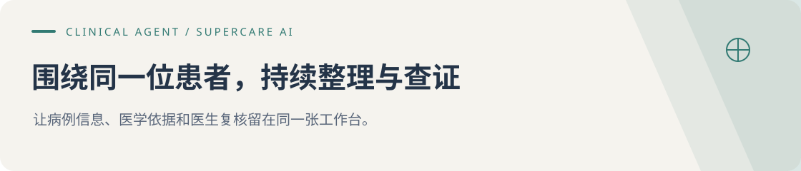

# Clinical Agent · 病例工作台

Clinical Agent 主要面向低年资及非精神科医生，帮助整理患者信息、查阅医学资料，并在继续提问时沿用已经确认的内容。工作台原名 **SuperCare AI**，与这里介绍的是同一个项目，临床判断始终由医生负责。

[看病例讨论示例](https://dominicspace-agent-showcase.peterzhukejie2020.chatgpt.site/apps/clinical/index.html) · [阅读设计思路](docs/product-design.md) · [看评测案例](https://dominicspace-agent-showcase.peterzhukejie2020.chatgpt.site/apps/evaluation/index.html?space=history&view=story) · [关于作者](https://github.com/DominicHongliDing)

## 第一次看，建议这样体验

1. [先看三步示例](https://dominicspace-agent-showcase.peterzhukejie2020.chatgpt.site/apps/clinical/index.html#example)：从一段不完整的虚构病例开始，看怎样整理已知信息、查资料、说明依据。
2. [浏览工作台](https://dominicspace-agent-showcase.peterzhukejie2020.chatgpt.site/apps/clinical/index.html?mode=browse)：无需填写 API Key。点击「使用虚构教学病例」，可以先检查材料，再导入病例。
3. 想发送问题时，再通过「连接模型」配置自己的 API Key。也可以直接[看一次已有测试](https://dominicspace-agent-showcase.peterzhukejie2020.chatgpt.site/apps/evaluation/index.html?space=history&view=story)，检查 AI 有没有采用用户更正的信息。

示例页说明产品思路，不展示现场生成的回答；已有测试保留原始问答与处理过程。

## 项目从哪里来

在卡罗莱纳精神病研究所实习期间，我参与了 VedAI 项目，定期与项目负责人、精神科医生和前后端工程师沟通。低年资及非精神科医生面对复杂病例时，往往需要先从较长的叙述里找出关键信息，再查阅资料，确定还需要了解哪些情况。

前期使用反馈中，有些问题反复出现：换个问题就要重新交代患者情况；回答看起来完整，却没用上重要的病例细节；有时附上了引用，结论还是说得过于肯定。

实习结束后，我带着这些问题继续做了 Clinical Agent。它以病例为单位保存资料，让医生能围绕同一位患者持续讨论，接着使用已确认的信息、参考资料和之前的意见。VedAI 是实习期间参与的团队产品，Clinical Agent 是我之后持续开发的个人项目。

## 医生可以怎样使用

| 当前任务 | 工作台提供的帮助 | 医生需要核对什么 |
|---|---|---|
| 整理一段复杂病例 | 提取主要信息，列出已知事实与缺失信息 | 摘要有无遗漏，是否符合原文 |
| 围绕同一患者继续提问 | 读取已确认信息，结合本轮问题回答 | 有没有采用最新补充，是否仍针对当前患者 |
| 查指南和用药资料 | 检索医学资料，展示引用与适用范围 | 来源是否可靠，能否用于当前患者 |
| 准备进一步问诊或病例讨论 | 整理待补充问题、风险线索和参考方向 | 哪些应优先核查，哪些仍然未知 |
| 复核 AI 结果 | 一起呈现回答、引用和医生反馈 | 采用、修改，或进一步复核 |

## 从整理病例到继续追问

页面分为病例与材料、当前对话、依据与待确认事项三个区域。医生先看回答，需要时再展开来源和处理细节。

## 我做了哪些设计选择

首先要解决的是信息怎么保存。围绕同一位患者，医生往往会连续讨论多个问题，所以资料按病例分别保存，并区分原始材料、AI 整理的内容和医生已确认的信息。后续提问时，就可以接着使用已确认的内容。

实习期间与医生、项目负责人和工程师的交流，也影响了我的设计方式。收到“回答需要更完整”这样的反馈时，还要问清具体缺了什么：关键问题没有回答，引用不够充分，还是遗漏了需要进一步确认的情况？弄清原因后，才能决定怎样调整回答和界面，并通过原型验证。

另一个重点是依据不足时，回答应该到哪一步。系统依次检查病例事实、医学资料和回答中的风险；必要时继续检索，仍无法确认的部分就说明还缺什么，不给出超出依据的结论。高风险结果交给医生复核，临床决策始终由医生负责。

## AI 在工作台里做什么

| 能力 | 用来处理什么问题 |
|---|---|
| 大模型与任务识别 | 分清医生本轮是要整理病例、查证资料，还是继续追问 |
| 上下文管理（Context Engineering） | 组织当前病例的已确认信息、近期对话和待解决问题，减少遗漏与重复输入 |
| 8 类专业 Skill | 分别为病例整理、鉴别思路、指南、用药安全、量表、风险、补充问诊与专科评估设置处理要求 |
| 检索增强生成（RAG） | 先查找、筛选医学资料，再据此组织回答，方便核对出处和适用性 |
| 分阶段检查与修正 | 分阶段核对事实、证据和回答，记录过程，发现问题后在对应阶段修正 |

这里的 Skill 可以理解为处理某类任务的规则：先收集哪些信息、怎样组织回答、哪些内容需要谨慎处理。它帮助模型按要求工作，医学依据仍需查阅资料，结果仍需医生判断。

## 如何判断设计有没有用

检查时，我会回到医生使用中的具体情形。比如，更正患者信息后，下一轮是否采用了新内容；资料不足时，是否说清还缺什么。重要结论要能找到相应引用，医生也要能方便地找到需要核对的部分。出现过问题的场景会保存下来，修改后再测一次。这也是我做 [Agent EVO 评测平台](https://github.com/DominicHongliDing/DominicHongliDing/blob/main/docs/agent-evo.md)的原因之一。

## 体验与项目范围

可以先看示例、浏览工作台，生成回答时再配置个人模型 API Key。在线体验与本地实现的范围有所不同，医生审核流程等设计详见[产品设计](docs/product-design.md)。演示请使用虚构或脱敏材料，生成内容需要医生复核。

这个仓库提供产品介绍与设计说明，尚未发布 Clinical 应用源码。
