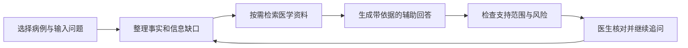

# Clinical Agent

面向精神科及需要精神科支持的医生，把病例整理、医学资料查证和结果复核放进同一张工作台。公开体验页使用 **SuperCare AI** 名称。

[打开工作台](https://dominicspace.com/apps/clinical/index.html) · [阅读设计思路](docs/product-design.md) · [看评测案例](https://dominicspace.com/apps/evaluation/index.html?space=history&view=story) · [关于作者](https://github.com/DominicHongliDing)

## 项目从哪里来

在卡罗莱纳精神病研究所实习、参与 VedAI 项目时，我接触到低年资及非精神科医生在复杂病例处理中的信息需求。医生需要从较长的叙述中整理关键信息，查找适用资料，还要判断哪些问题需要继续追问。

前期使用反馈中，单轮问答容易暴露几类问题：换一个问题，就要重新交代患者情况；回答看起来完整，却漏了病例里的细节；引用了相关资料，也未必足以支持具体结论。

实习结束后，我基于这些问题继续迭代 Clinical Agent。产品以“同一患者的连续工作”为单位，让病例事实、当前问题、参考证据和医生意见能够一起保留下来。

## 医生可以怎样使用

| 当前任务 | 工作台提供的帮助 | 医生需要核对什么 |
|---|---|---|
| 整理一段复杂病例 | 提取主要信息，区分已有事实与缺失信息 | 摘要是否忠于原文，有无遗漏或错误 |
| 围绕同一患者连续追问 | 复用已确认信息，结合本轮问题组织回答 | 是否采用最新补充，是否仍针对当前患者 |
| 查找相关指南和用药资料 | 检索医学资料，展示引用及支持范围 | 来源与患者情况是否适用 |
| 准备进一步问诊或病例讨论 | 整理待补充问题、风险线索和参考方向 | 哪些需要优先核查，哪些信息仍未知 |
| 复核 AI 结果 | 将回答、依据和医生反馈放在一起 | 是否采用、修改，或交由进一步复核 |

## 一次工作的过程

产品围绕三个区域组织信息：病例与材料、当前对话、依据与待确认事项。医生可以先阅读结果，再检查来源和处理细节；技术流程不要求成为使用前提。

## 我做了哪些设计选择

### 用病例承接连续工作

一次提问结束后，患者的信息还要继续使用。我将已确认事实与当前病例关联，区分材料原文、模型整理和医生确认，减少在多轮对话里反复输入的负担。不同病例之间保持隔离。

### 把“回答更完整”拆成具体要求

在和医生、项目负责人及前后端工程师的交流中，我把反馈拆成可讨论的产品要求：有没有回应关键问题、有没有说明依据、有没有列出待核对事项。这些要求进入输出结构、界面和测试场景，再通过原型与反馈继续调整。

### 让证据不足也有清楚的处理方式

相关资料不一定足以回答当前问题。因此流程分别检查病例事实、医学证据与回答安全性；必要时补充检索或缩小回答范围，高风险结果交给医生复核。AI 负责辅助整理和查证，临床决策由医生作出。

## AI 技术为什么放在这里

| 能力 | 在产品中的作用 | 对应的问题 |
|---|---|---|
| 大模型与任务识别 | 理解医生本轮需要整理、查证还是继续追问 | 相似措辞可能对应不同工作 |
| 上下文管理（Context Engineering） | 组织当前病例的已确认信息、近期对话和未解决问题 | 多轮遗漏、重复输入与病例混淆 |
| 8 类专业 Skill | 为病例整理、鉴别思路、指南、用药安全、量表、风险、补充问诊与专科评估规定输出和边界 | 相同问题的回答结构与检查要求不稳定 |
| 检索增强生成（RAG） | 从医学资料中检索、筛选证据，再组织回答 | 单靠模型记忆难以核对出处与适用性 |
| 工作流与有限返修 | 将事实、证据、回答检查分阶段组织，保留过程记录 | 出错后难以定位和有针对性地修正 |

Skill 在这里是一组专业任务规则，规定需要什么信息、怎样组织结果、有哪些限制。它不替代医学知识来源或医生判断。

## 如何判断设计有没有用

我用具体任务检查产品：修改患者信息后，下一轮是否采用新内容；缺少资料时，是否说明缺口；关键结论是否有对应依据；医生能否找到需要核对的部分。失败案例会进入后续版本对照，这也促使我继续做了 [Agent EVO 评测平台](https://github.com/DominicHongliDing/DominicHongliDing/blob/main/docs/agent-evo.md)。

## 体验与项目范围

工作台可以先浏览界面，生成回答需要配置个人模型 API Key。公开体验与本地完整实现的能力范围有所不同；完整医生审核流程等设计说明见[产品设计](docs/product-design.md)。演示请使用虚构或脱敏材料，生成内容需要医生复核。

VedAI 是我在实习期间参与的团队产品；Clinical Agent 是此后的个人持续迭代。这是产品介绍仓库，应用源码尚未在此发布。
