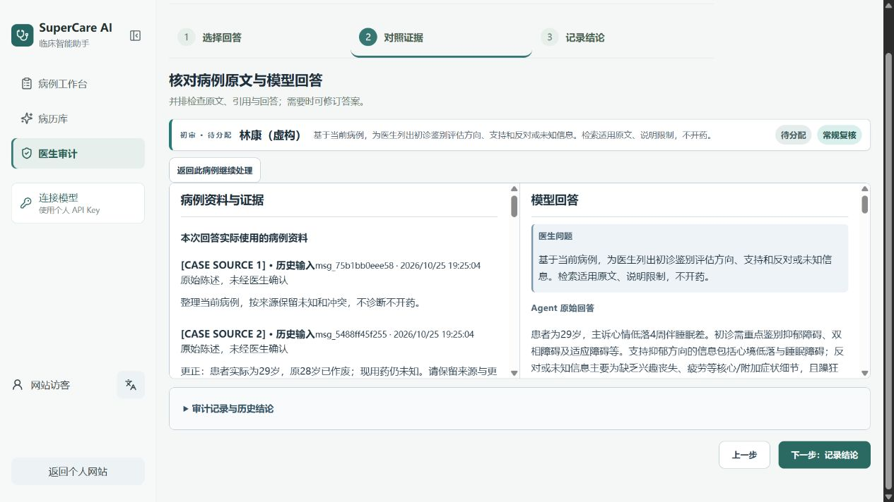
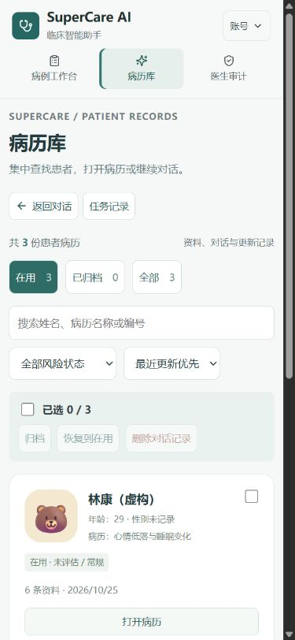

# 2026-10-25 · 病例工作台与 Agent 能力更新

[返回项目](../../README.md) · [在线工作台](https://dominicspace.com/apps/clinical/) · [产品设计](../product-design.md) · [v0.4 PRD](../PRD-v0.4.md)

本次同步个人网站的最新前端、公开产品说明和本地工程进展。应用源码与本地数据库不在本公开仓库中。

[GitHub 网页版构建包](https://github.com/DominicHongliDing/Clinical-Agent/releases/tag/website-2026.10.25)包含当前入口实际引用的 HTML、JS、CSS 与图标，并附逐文件 SHA-256 清单。它是已发布前端的静态构建产物，不是完整应用源码或数据库服务。

## 用户可见变化

- 病历库增加头像、搜索、风险筛选、排序、归档与批量管理。
- 病历资料统一进入 EHR；编辑身份信息后，同步到聊天页、列表与病历库。
- 页头压紧，导航与证据栏可收起，减少对聊天空间的占用。
- 医生审计采用「选择回答 → 对照证据 → 记录结论」；病例原文与模型回答并排核对，领取后保留步骤。
- 网站预置 3 例虚构病例与 6 份实际模型回答，回答和引用保持采样原文，无需 Key 即可查看。

上图来自发布前的网页版预览，使用虚构病例；下图为正式网站窄屏病历库。界面中的软件测试记录不代表独立临床评分。

## 线上与本地的交付范围

| 项目 | 本次状态 |
| --- | --- |
| 网站入口 | https://dominicspace.com/apps/clinical/ |
| 网站前端 | 同步最新 React 组件与样式，发布于个人网站 |
| 网站新生成 | 延用既有公开 BYOK 网关，访客使用自己的 API Key |
| 网站记录 | 当前浏览器会话 sessionStorage；刷新保留，非跨设备数据库 |
| 本地完整 Agent | 技能／工具自主选择、受限循环、上下文与 RAG、PostgreSQL 保存；没有随前端部署 |
| 医生审计 | 网页为会话内体验；本地为真实数据库任务及提交记录 |

个人 API Key 仅保存在运行时内存中，不写入 sessionStorage。新标签页、关闭会话、清除存储或换设备的持久性不作保证。网站没有机构级多人独立复核，也没有发布本地数据库或测试账号。

## 本地工程验证摘要

依据本地冻结的 2026-10-25 验收记录整理；原始运行日志与数据库不公开，以下为公开范围的摘要。[机器可读摘要](evidence/2026-10-25-validation.json)保留样本口径与版本。

| 检查 | 结果 | 解释范围 |
| --- | --- | --- |
| 确定性测试 | 679 项通过 | 覆盖工具、检索、病例隔离、所有权、上下文与终态等；不代替临床评审 |
| 两技能真实模型基线 | 6 个虚构病例 × 2 技能，共 12 次请求 | 病例整理与鉴别评估均实际加载 v0.4 |
| 完成与持久化 | 12/12、12/12 | 接口终态与答案快照；不代表临床正确 |
| full 模式与详情导出 | 12/12、12/12 | 完整任务的模式与结构存在；不证明语义质量 |
| 提交引文原文匹配 | 14/14 | 分母仅为提交的引文链接；不等于临床支持率 |
| 延迟 P50 / P95 | 27.685 / 69.389 秒 | 12 次请求的经验 nearest-rank；不是生产 SLA 或改进显著性结论 |
| 实际用户关键流程 | 输入、补充更正、生成、审计提交、切换病例及刷新已核对 | 包含连续年龄更正与病例恢复；不等于历史失败的同条件复测 |
| 原数据保留 | 原 4 病例、4 消息、4 审计、1167 知识片段内容指纹不变 | 虚构验收记录另行新增 |

运行快照使用回答合同 v4 与检索策略 v3。混合 RAG 具备查询改写、BM25、百炼语义检索、RRF 和百炼重排；索引有 1167 个来源及 1209 个当前窗口。20 条查询的 140 对候选池已冻结，独立裁决标签仍为 0，未报告 Recall / nDCG 或临床支持改善。

## 网站同步验证摘要

- TypeScript 检查与 Vite 构建通过。
- 14 项适配器夹具检查覆盖 EHR 并发保存、身份信息、病例隔离、审计状态、刷新保存、Key 不入存储及成功／失败事件。这些是夹具检查，不是真实模型验收。
- 真实浏览器检查桌面 1280×800、窄屏 390×844 关键流程；姓名修改同步到聊天，领取保持第三步，审计提交后刷新能恢复，无横向溢出。
- 正式域名确认新版界面、三例病历与模型目录加载；软件测试审计提交及刷新保存已核对。
- 本次网站同步没有新增付费模型生成，也没有重测真实麦克风、附件及全部供应商。
- 发布后的批量 HTTP 文件指纹核对遇到 TLS 握手超时，未算通过；正式域名使用浏览器实际核对。

公开示例中的六份回答来自上述本地真实采样的前三例，回答正文和引用与冻结记录相同；虚构姓名与头像用于病历组织。病例模块只整理已有资料，不补写未知事实。当前回答仍待医生独立评阅。

## 未完成项与历史记录

1. 医生独立评分、证据适用性与参考回答尚未完成；本地用户验收通过不等于临床批准。
2. RAG 独立标注、临床质量阈值，以及其余六技能的分层回答推广仍待后续决定。
3. 持久 worker、跨进程续跑和额外并行暂缓；当前只有同机进程退出识别和已保存结果恢复，不能宣称持久任务队列已经完成。
4. 偏好作用域独立存储、生产机构隔离、备份恢复、并发限流等仍需单独验收。
5. [两周更正为三天的历史失败](../cases/patient-correction.md)保留；本轮新版其他更正用例与该历史同条件复测分开记录。

本轮没有真实临床试点，没有八技能临床批准，也没有用软件测试审计替医生签署。
